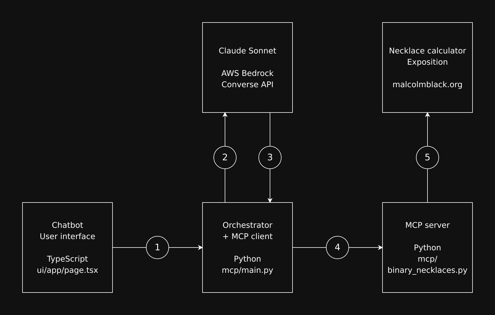
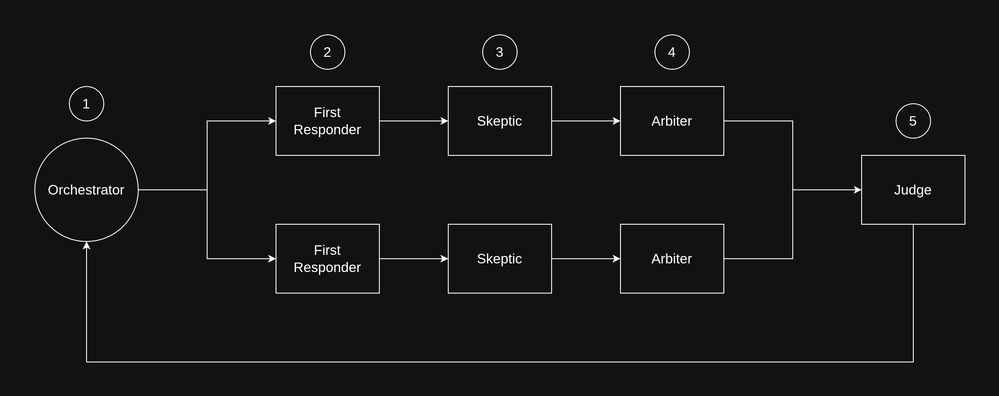

# Binary Necklace Chatbot

The chatbot answers questions about [Binary Necklaces](https://malcolmblack.org/binary-necklaces.html) using its exposition reference and calculator. It uses an MCP tool server and a FastAPI orchestrator with AWS Bedrock.



The UI sends a question to `/mcp`. Two First Responder → Skeptic → Arbiter sequences run in parallel, and a Judge combines their conclusions. Each role uses the same terminology guidance and exposition. The Skeptic checks for errors without assuming the first answer must be wrong. The Bedrock model and orchestration count are unchanged.



The default question is: “Is the necklace represented by 1100101 fixed by the adjacent-XOR map?” Word equality and necklace equality are distinct: this necklace is fixed even though its literal image word differs. The tool response now makes that distinction explicit.

`mcp/binary_necklaces.py` supplies `get_properties` and `research://binary-necklaces-exposition`. `mcp/bitloops.py` and `research://bitloops-paper` remain compatibility aliases. The reference is fetched from `/binary-necklaces/binary-necklaces.yml`; an invalid, obsolete, or unavailable response falls back to the bundled reference in `mcp/knowledge/`. Restart the server after changing the reference: the orchestrator caches it at startup.

The former evaluation results are preserved in [the historical evaluation note](notes/legacy-evaluation.md) and `mcp/test/`. They are not accuracy measurements for these updated prompts or terminology.

## Development and deployment

For the service:

```bash
cd mcp
uv sync --frozen
uv run uvicorn main:app --host 127.0.0.1 --port 8000
```

Bedrock and CloudWatch require the existing AWS environment or instance role. The service retains its configured model, region, `/mcp` and `/health` routes, and `BitloopsChatbot` metric namespace. No cloud resource rename is required. The optional `BINARY_NECKLACES_REFERENCE_URL` selects a reference URL; set it to an empty string to use only the bundled copy. `BINARY_NECKLACES_CALCULATOR_URL` optionally overrides the calculator URL.

For the UI:

```bash
cd ui
npm ci
npm run build
```

The static export is `ui/out/`, with base path `/binary-necklaces/chatbot`. Next's intermediate build files are in `ui/.next/`. The default MCP URL is the current origin; a build-time `NEXT_PUBLIC_MCP_URL` can select another backend. For local development use `npm run dev` and open `/binary-necklaces/chatbot/`.

`ui-push.sh` publishes the existing export to `s3://malcolmblack.org/binary-necklaces/chatbot/`. Set `WEB_BUCKET` to override the bucket and `CLOUDFRONT_DISTRIBUTION_ID` to invalidate a known distribution. The script performs deployment only when explicitly run. `mcp.zip` is the refreshed server bundle; `mcp-build.sh` retains the local/EC2 deployment blocks, which should be run separately as indicated.

Run offline regression checks from the repository root with `python3 -m unittest discover -s tests -v`. `mcp/test.py` and `mcp/test/test_temperature.py` are the historical live evaluation runners; they invoke Bedrock repeatedly and are not part of the offline tests.
