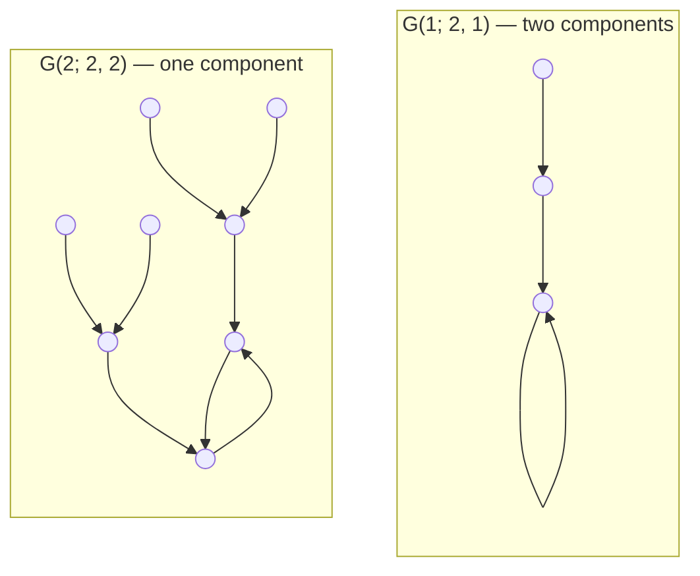

# The Partitioning of Power Sets Into Graphs

## Abstract

Let a cyclic permutation act on the power set of an $n$-element set, and let evolution be symmetric difference with the cyclic translate. Since these operations commute, evolution induces a functional graph on the rotation classes of subsets. Its connected components induce a partition of the power set. We give a self-contained algebraic description of the component types, their multiplicities, and the cardinalities of the corresponding parts. Writing $n=2^a m$ with $m$ odd, we separate a nilpotent coordinate from an invertible periodic coordinate. Every component is a directed cycle with identical level-regular rooted trees attached. Its cycle length determines its tree shape at fixed $n$. Simultaneous rotation and evolution relations form a rank-two integer lattice; passing from squarefree factors to repeated factors multiplies this lattice by a power of two. Consequently, finitely many integer polynomials associated with an odd $m$ describe the partitions for every $m2^a$. Powers of two and the families $3\cdot2^a$, $5\cdot2^a$, and $7\cdot2^a$ admit explicit formulas. A second description, using rotation averaging and two Möbius inversions, expresses all component multiplicities through polynomial greatest common divisors. Both descriptions establish disjointness and exhaustiveness without choosing individual subsets.

**Keywords.** Power sets; binary necklaces; Ducci map; additive cellular automata; functional graphs; finite fields; Möbius inversion.

## 1. Introduction and definitions

Let $X_n=\mathbb Z/n\mathbb Z$, with cyclic permutation $i\mapsto i+1$. For $A\subseteq X_n$, write $R(A)=\{i+1:i\in A\}$ and define 

$$
D(A)=A\mathbin{\triangle}R(A),
\tag{1.1}
$$

 where $\triangle$ denotes symmetric difference. The cyclic order is part of the structure; different cyclic labelings give isomorphic constructions. Under characteristic vectors, $\mathcal P(X_n)$ is the vector space $V_n=\mathbb F_2^n$, rotation is a linear map $R$, and $D=I+R$.

A *necklace* is an orbit under $\langle R\rangle$. Let $\mathcal N_n=V_n/\langle R\rangle$, with projection $\pi_n$. Since $DR=RD$, the rule $[v]\mapsto[Dv]$ defines a map $\overline D$ on $\mathcal N_n$. Let $\mathcal Q_n$ be its functional digraph: every necklace is a vertex, and its unique outgoing edge points to its image under $\overline D$. Loops are retained. A *component* means a weakly connected component, obtained by ignoring edge directions when testing connectivity. Each component consists of one directed cycle and trees directed toward that cycle.

For a component $C$ of $\mathcal Q_n$, define its *mass* by 

$$
\lVert C\rVert=|\pi_n^{-1}(V(C))|.
\tag{1.2}
$$

 The sets $\pi_n^{-1}(V(C))$ partition $\mathcal P(X_n)$. This is the sense in which the power set is partitioned into graphs: graph vertices are rotation classes, while each part of the power set is their union. The number of vertices in a component and its mass are different quantities. Isomorphic components need not have the same mass.

The map $D$ is the binary Ducci map, within the theory of additive cellular automata. Martin, Odlyzko, and Wolfram developed polynomial methods and algebraic descriptions of finite state-transition graphs [1]. Misiurewicz, Stevens, and Thomas studied iterations of related linear maps over finite fields, including the passage from dimension $n$ to dimension $2n$ and counts of periodic vectors [2]. Breuer, Lötter, and van der Merwe related Ducci periods to polynomial orders and multiplicative orders in finite fields [3]. The emphasis here is the quotient by cyclic rotation and the simultaneous relations between rotation and evolution. All structural and counting statements needed for this quotient are proved below.

Throughout, write uniquely 

$$
n=qm,\qquad q=2^a,\qquad a\in\mathbb Z_{\ge0},\qquad m\text{ odd}.
\tag{1.3}
$$

 Thus $a=v_2(n)$ is the exponent of $2$ in $n$. The main results are as follows. The component classification in Theorem 2.1 identifies every component through a polynomial divisor and a coset of a finite group. Theorem 3.1 gives its complete directed-graph shape. The lattice lifting theorem, Theorem 4.1, yields the finite polynomial description of all $m2^a$ in Theorem 4.3. Finally, Theorem 6.2 gives an independent counting formula for every positive integer $n$.

## 2. The algebraic partition

### 2.1. Nilpotent and periodic coordinates

Identify $V_n$ with $\mathbb F_2[x]/(x^n+1)$ by sending a vector to its coordinate polynomial. Then $R$ and $D$ act by multiplication by $x$ and $1+x$, respectively. Put 

$$
Q_m(x)=\frac{x^m+1}{x+1},\qquad P_n(x)=Q_m(x)^q.
\tag{2.1}
$$

 For $m=1$, $Q_m=P_n=1$. Since $m$ is odd, $x^m+1$ is squarefree, and $Q_m$ is relatively prime to $x(x+1)$. Moreover, 

$$
x^n+1=(x+1)^q Q_m(x)^q,\qquad
 V_n\simeq K_q\oplus W_n,
\tag{2.2}
$$

 where 

$$
K_q=\mathbb F_2[y]/(y^q),\quad y=x+1,
 \qquad W_n=\mathbb F_2[x]/P_n(x).
$$

 The quotient by the polynomial $1$ is understood as the zero vector space. On $K_q$, rotation is multiplication by $1+y$ and evolution by $y$. On $W_n$, both $x$ and $1+x$ are units. Thus $K_q$ is the nilpotent part, and $W_n$ is the periodic part. In particular, a vector is periodic under $D$ exactly when its $K_q$ coordinate is zero.

### 2.2. Annihilator strata and relation lattices

For $w\in W_n$, its *annihilator polynomial* is the monic generator $H$ of $\{f\in\mathbb F_2[x]:fw=0\}$; necessarily $H\mid P_n$. Set 

$$
W_n(H)=\{w\in W_n:\mathop{\mathrm{Ann}}(w)=(H)\}.
$$

 If $P_n=BH$, multiplication by $B$ identifies $W_n(H)$ with 

$$
U(H)=(\mathbb F_2[x]/H)^\times.
\tag{2.3}
$$

 Indeed $w=Bu$ has annihilator $H$ precisely when $\gcd(u,H)=1$. For $H=1$, the stratum is $\{0\}$; we use a one-element group as $U(1)$. Write 

$$
\Phi(H)=|U(H)|,
 \qquad
 \Phi\left(\prod_i f_i^{e_i}\right)
 =\prod_i (2^{\deg f_i}-1)2^{(e_i-1)\deg f_i},
 \qquad \Phi(1)=1.
\tag{2.4}
$$

For $H\ne1$, define 

$$
\Lambda_H=\{(u,v)\in\mathbb Z^2:x^u(1+x)^v=1\pmod H\}.
\tag{2.5}
$$

 Negative exponents are permitted because $x$ and $1+x$ are units. There are unique integers $d_H,t_H>0$ and $0\le s_H<d_H$ such that 

$$
\Lambda_H=\langle(d_H,0),(-s_H,t_H)\rangle.
\tag{2.6}
$$

 Here $d_H$ is the order of $x$ modulo $H$, $t_H$ is the least positive integer for which $(1+x)^{t_H}\in\langle x\rangle$, and $(1+x)^{t_H}=x^{s_H}$. Since $H\mid x^n+1$, $d_H\mid n$. The subgroup 

$$
\Gamma_H=\langle x,1+x\rangle\le U(H)
$$

 has order $d_Ht_H$, by the homomorphism from $\mathbb Z^2$ with kernel $\Lambda_H$. For $H=1$, set $(d_H,t_H,s_H)=(1,1,0)$ and take $\Gamma_H$ to be trivial.

**Theorem 2.1 (Component classification).**

The components of $\mathcal Q_n$ are in bijection with the disjoint union 

$$
\bigsqcup_{H\mid P_n} U(H)/\Gamma_H.
\tag{2.7}
$$

 For a fixed $H$, there are $\Phi(H)/(d_Ht_H)$ components. Each has a cycle of length $t_H$, and its mass is $2^q d_Ht_H$. Consequently, 

$$
\sum_{H\mid P_n}\frac{\Phi(H)}{d_Ht_H}\,2^q d_Ht_H=2^n.
\tag{2.8}
$$

*Proof.* Both $R$ and $D$ preserve each annihilator stratum and act on it as multiplication by $x$ and $1+x$. Their joint orbits are precisely the cosets of $\Gamma_H$, each of size $d_Ht_H$. Quotienting such an orbit by rotation leaves $t_H$ vertices, on which $D$ acts as one cycle.

Every vector with periodic coordinate in this joint orbit reaches that cycle after at most $q$ applications of $D$, because $y^q=0$ on $K_q$. Conversely, neither a rotation nor an evolution edge can move the periodic coordinate to a different joint orbit. Thus all $2^q d_Ht_H$ vectors in the product of $K_q$ with the joint orbit form the inverse image of exactly one component. This proves the asserted bijection and mass.

The CRT coordinates, annihilator polynomial, and coset are unique, proving disjointness. They exhaust $V_n$, proving exhaustiveness. Equivalently, $\sum_{H\mid P_n}\Phi(H)=2^{\deg P_n}=2^{n-q}$, which gives (2.8). $\square$

## 3. The directed-graph structure

For powers of two $h\mid q$, let $\mathcal T(q,h)$ be the rooted tree of depth $q$ defined as follows. The root has one child. At depth $j$, where $1\le j<q$, every vertex has 

$$
b_j(q,h)=
 \begin{cases}
 1,&j\in\{h,2h,4h,\ldots,q/2\},\\
 2,&\text{otherwise}
 \end{cases}
\tag{3.1}
$$

 children. The set in the first line is empty if $h=q$. All edges point toward the root. Let $\mathcal G(T;q,h)$ be a directed cycle of length $T$ with a copy of $\mathcal T(q,h)$ attached at each cycle vertex, identifying its root with that vertex. For $T=1$ the cycle is a loop.

This specifies the graph up to isomorphism. An optional finite-word encoding is 

$$
G_T\text{-}\sigma(q,h),\qquad
 \sigma(q,h)=2b_1(q,h)\cdots b_{q-1}(q,h)0.
\tag{3.2}
$$

 Juxtaposition in $\sigma(q,h)$ denotes concatenation in a word over $\{0,1,2\}$. The initial symbol $2$ records the total indegree at a cycle vertex, including its cycle predecessor; it does not mean that the rooted tree has two children at its root.

**Theorem 3.1 (Uniform attached trees).**

For a component belonging to $H$ in Theorem 2.1, put $d=d_H$, $t=t_H$, and $h=\gcd(d,q)$. Its graph is $\mathcal G(t;q,h)$. In particular, the graph shape is independent of the coset and of $s_H$.

*Proof.* Choose a periodic coordinate $w_0$ in the joint orbit and representatives $w_i=D^i w_0$, $0\le i<t$, for its rotation orbits. Every necklace over the orbit of $w_i$ has a representative $(u,w_i)$, with $u\in K_q$. Two such representatives define the same necklace precisely when their $K_q$ coordinates differ by a power of $(1+y)^d$. Thus the fiber over each core necklace is 

$$
K_q/\langle(1+y)^d\rangle
 =K_q/\langle(1+y)^h\rangle.
\tag{3.3}
$$

 The equality holds because $1+y$ has order $q$ and $h=\gcd(d,q)$.

The map $D$ sends the fiber at $i$ to the fiber at $i+1$ by multiplication by $y$, except at $i=t-1$, where returning to the representative $w_0$ introduces the factor $(1+y)^{-s_H}$. This factor is a unit, commutes with $y$, and preserves nilpotent height. It cannot change any of the following preimage counts.

Define $\mathop{\mathrm{ht}}(0)=0$ and $\mathop{\mathrm{ht}}(u)=\min\{j\ge1:y^ju=0\}$ for $u\ne0$. There are $2^{j-1}$ elements of height $j$. Under multiplication by $(1+y)^h=1+y^h$, every height-$j$ element has the same orbit length 

$$
\rho_h(j)=\min\{2^b:b\ge0,\ h2^b\ge j\}.
\tag{3.4}
$$

 Indeed $(1+y^h)^{2^b}=1+y^{h2^b}$, and its action fixes a height-$j$ element exactly when $h2^b\ge j$.

For $1\le j<q$, a height-$j$ orbit has $2\rho_h(j)$ preimage elements under multiplication by $y$, all of height $j+1$. They split into orbits of length $\rho_h(j+1)$. Hence every vertex at depth $j$ has 

$$
\frac{2\rho_h(j)}{\rho_h(j+1)}=b_j(q,h)
$$

 children. A cycle vertex has one incoming cycle edge and one transient predecessor, since $\ker(y)$ contains zero and one nonzero element, both fixed under the rotation subgroup. Height-$q$ vertices have no preimages. Height decreases by one at every transient step, so it equals distance to the cycle. These uniform branching numbers determine the incoming rooted tree at each cycle vertex, proving the assertion. $\square$

**Corollary 3.2 (Vertex counts).**

The tree $\mathcal T(q,h)$ has one root and 

$$
v_j(q,h)=\frac{2^{j-1}}{\rho_h(j)}\qquad(1\le j\le q)
\tag{3.5}
$$

 vertices at depth $j$. Writing $q=2^a$ and $h=2^b$, its total size is 

$$
A(q,h)=1+\sum_{j=1}^q v_j(q,h)
 =\frac hq\left(2^q+\sum_{r=1}^{a-b}2^{r-1}2^{q/2^r}\right).
\tag{3.6}
$$

 Thus $\mathcal G(T;q,h)$ has $TA(q,h)$ vertices and the same number of directed edges, counting cycle edges and loops.

*Proof.* Equation (3.5) follows from the height-orbit calculation. For the second expression in (3.6), apply Burnside’s lemma to $K_q/\langle R^h\rangle$. Its acting group has order $q/h$. A rotation $R^{hk}$ fixes $2^{\gcd(q,hk)}$ vectors. Grouping the rotations by their orders $2^r$ gives one identity contribution $2^q$ and $\varphi(2^r)=2^{r-1}$ contributions $2^{q/2^r}$ for each $r\ge1$, where $\varphi$ is Euler’s totient function. $\square$

## 4. Lifting along families with fixed odd part

Fix an odd $m>1$ and factor 

$$
Q_m=\prod_{i=1}^r f_i
\tag{4.1}
$$

 into distinct monic irreducibles over $\mathbb F_2$. Write $r_i=\deg f_i$. For a nonempty support $S\subseteq\{1,\ldots,r\}$, put $F_S=\prod_{i\in S}f_i$ and write 

$$
\Lambda_S=\Lambda_{F_S}
 =\langle(d_S,0),(-s_S,t_S)\rangle.
$$

 Both $d_S$ and $t_S$ are odd, since $U(F_S)$ is a product of finite-field multiplicative groups of odd order.

**Theorem 4.1 (Lifting the joint relation lattice).**

Let $H=\prod_{i\in S}f_i^{e_i}$, where all $e_i\ge1$, and let 

$$
E=\max_{i\in S}e_i,\qquad h=2^{\lceil\log_2 E\rceil}.
\tag{4.2}
$$

 Then 

$$
\Lambda_H=h\Lambda_S,
 \qquad (d_H,t_H,s_H)=h(d_S,t_S,s_S).
\tag{4.3}
$$

*Proof.* For a nonzero integer pair $(u,v)$, write $(u,v)=2^b(u_0,v_0)$, with at least one of $u_0,v_0$ odd. In the rational function field $\mathbb F_2(x)$, 

$$
x^u(1+x)^v-1=
 \bigl(x^{u_0}(1+x)^{v_0}-1\bigr)^{2^b}.
$$

 Differentiating gives 

$$
\frac{d}{dx}\bigl(x^{u_0}(1+x)^{v_0}-1\bigr)
 =x^{u_0}(1+x)^{v_0}
   \frac{u_0(1+x)+v_0x}{x(1+x)}.
\tag{4.4}
$$

 The numerator in the final fraction is, modulo $2$, one of $1$, $x$, or $1+x$. None vanishes at a root of any $f_i$. Every zero of the expression inside parentheses at such a root is therefore simple. This argument also applies to negative exponents because the denominators have no zero there.

If $(u,v)\in\Lambda_S$, then $(u_0,v_0)\in\Lambda_S$: raising to the $2^b$-th power is an automorphism of the odd-order group $U(F_S)$. It follows that a nonzero squarefree relation $(u,v)$ has exactly multiplicity $2^b$ at every active factor. It holds modulo $H$ if and only if $2^b\ge E$, or equivalently if both coordinates are divisible by $h$. Thus 

$$
\Lambda_H=\Lambda_S\cap h\mathbb Z^2.
$$

 The index $[\mathbb Z^2:\Lambda_S]=d_St_S$ is odd. Multiplication by $h$ is therefore an automorphism of $\mathbb Z^2/\Lambda_S$, which implies $\Lambda_S\cap h\mathbb Z^2=h\Lambda_S$. The zero relation belongs to both sides. Multiplying the canonical basis by $h$ proves the last assertion. $\square$

**Corollary 4.2 (Cycle length determines graph type).**

For every positive integer $n=qm$, a component of cycle length $T$ has graph 

$$
\mathcal G\bigl(T;q,2^{v_2(T)}\bigr).
\tag{4.5}
$$

 Thus two components of $\mathcal Q_n$ with equal cycle lengths are isomorphic as directed graphs.

*Proof.* For nonempty support, Theorem 4.1 gives $d_H=hd_S$ and $T=ht_S$ with $d_S,t_S$ odd. Since $h\mid q$, $\gcd(d_H,q)=h=2^{v_2(T)}$. Apply Theorem 3.1. For $H=1$, both the cycle length and $h$ equal $1$. $\square$

### 4.1. A finite polynomial description

For each nonempty support $S$, define 

$$
C_S(z)=\prod_{i\in S}(z^{r_i}-1).
\tag{4.6}
$$

 Supports with the same relation lattice may be grouped. For each such lattice $\lambda$, with canonical parameters $(d_\lambda,t_\lambda,
s_\lambda)$, set 

$$
C_\lambda(z)=\sum_{S:\Lambda_S=\lambda} C_S(z).
\tag{4.7}
$$

 Include one additional, empty state $\lambda_0$ with parameters $(1,1,0)$ and polynomial $C_{\lambda_0}=1$. No nonempty support has this lattice: otherwise $x=1$ modulo one of the factors of $Q_m$, which is impossible. When $m=1$, the empty state is the only state.

For a nonempty state and a power of two $h$, define 

$$
W_\lambda(h)=
 \begin{cases}
 C_\lambda(2),&h=1,\\
 C_\lambda(2^h)-C_\lambda(2^{h/2}),&h>1.
 \end{cases}
\tag{4.8}
$$

**Theorem 4.3 (All doublings from finitely many polynomials).**

Fix an odd positive integer $m$. The finite collection $\{(d_\lambda,t_\lambda,s_\lambda,C_\lambda)\}$ determines the partition for every $n=qm$, $q=2^a$. There is one component $\mathcal G(1;q,1)$ of mass $2^q$ arising from the empty state. For each nonempty state $\lambda$ and each $h\in\{1,2,4,\ldots,q\}$, there are exactly 

$$
\frac{W_\lambda(h)}{h^2d_\lambda t_\lambda}
\tag{4.9}
$$

 components of graph type $\mathcal G(ht_\lambda;q,h)$, each of mass 

$$
2^q h^2d_\lambda t_\lambda.
\tag{4.10}
$$

 Contributions giving the same graph type are added. The components are disjoint and exhaustive.

*Proof.* For an irreducible $f$ of degree $r$, 

$$
\sum_{e=1}^{b}\Phi(f^e)=2^{rb}-1.
\tag{4.11}
$$

 Thus for fixed support $S$, summing $\Phi(H)$ over exponent choices $1\le e_i\le b$ gives $C_S(2^b)$. The choices for which the least power of two at least $\max_i e_i$ is $h>1$ have total weight $C_S(2^h)-C_S(2^{h/2})$; for $h=1$ the weight is $C_S(2)$. Summing over equal lattices yields (4.8).

By Theorem 4.1, all these strata have parameters $(hd_\lambda,ht_\lambda,hs_\lambda)$. Theorems 2.1 and 3.1 give the multiplicity, mass, and graph type. In particular, the fractions in (4.9) are integers. All weights are positive: each level contains at least the exponent choice $e_i=h$ on each support. The regrouping does not alter the partition established in Theorem 2.1. $\square$

The polynomial identity 

$$
\sum_\lambda C_\lambda(z)
 =\prod_{i=1}^r\bigl(1+(z^{r_i}-1)\bigr)=z^{m-1}
\tag{4.12}
$$

 gives an additional expression of completeness. The weights telescope over the dyadic levels, so 

$$
2^q\left(1+
 \sum_{\lambda\ne\lambda_0}\sum_{h=1,2,4,\ldots,q}W_\lambda(h)\right)
 =2^q\sum_\lambda C_\lambda(2^q)=2^{mq}.
\tag{4.13}
$$

 This equality accompanies the disjointness proof; equality of total masses alone would not establish a partition.

**Corollary 4.4 (Number of graph types).**

For $m>1$, let $\mathcal S_m$ be the set of integers $t_S$ arising from nonempty supports in (4.1). Then the number of directed-graph isomorphism types in $\mathcal Q_{m2^a}$ is 

$$
(a+1)|\mathcal S_m|+\mathbf 1_{\{1\notin\mathcal S_m\}}.
\tag{4.14}
$$

 For $m=1$ there is exactly one type.

*Proof.* Each nonempty state contributes positively at every dyadic level. The cycle lengths are $h\mathcal S_m$, and different levels have different $2$-adic valuations. Within each level, cycle length determines the graph by Corollary 4.2. The empty state adds a type precisely when $1$ is absent at level $h=1$. $\square$

## 5. Explicit infinite families

### 5.1. Powers of two

**Corollary 5.1.**

For every $a\ge0$, the graph $\mathcal Q_{2^a}$ is connected and isomorphic to $\mathcal G(1;2^a,1)$. Its mass is $2^{2^a}$.

*Proof.* Here $m=1$, so the periodic coordinate is zero and only the empty state occurs. Alternatively, $D^{2^a}=I+R^{2^a}=0$, so every vertex reaches the zero necklace. Theorem 3.1 gives the tree shape. $\square$

For $q=2^a$, the branching sequence has an internal symbol $1$ exactly at depths $1,2,4,\ldots,q/2$. The first cases are 

$$
\begin{array}{c|ccccc}
 q&1&2&4&8&16\\\hline
 \sigma(q,1)&20&210&21120&211212220&21121222122222220.
 \end{array}
$$

 The vertex count is the binary-necklace number 

$$
A(q,1)=\frac1q\sum_{d\mid q}\varphi(d)2^{q/d}
 =\frac1q\left(2^q+\sum_{r=1}^{a}2^{r-1}2^{q/2^r}\right).
\tag{5.1}
$$

 Equations (3.1) and (5.1) describe every member of this family without expanding the graph.

### 5.2. Odd parts three and five

For $m=3$, $Q_3=x^2+x+1$ is irreducible, and $1+x=x^2$ modulo $Q_3$. The only nonempty state is therefore 

$$
(d,t,s)=(3,1,2),\qquad C(z)=z^2-1.
$$

 For $m=5$, $Q_5=x^4+x^3+x^2+x+1$ is irreducible: a root has order $5$ and degree $\mathop{\mathrm{ord}}_5(2)=4$. Modulo $Q_5$, $(1+x)^3=x^4$, while $1+x\notin\langle x\rangle$. Hence its only nonempty state is 

$$
(d,t,s)=(5,3,4),\qquad C(z)=z^4-1.
$$

 Theorem 4.3 gives the following complete lists. In the table, $q=2^a$, and $h\ge2$ ranges over powers of two at most $q$.

| $n$  | Graph type           | Multiplicity                   | Mass of each component |
|:----:|:---------------------|:-------------------------------|:-----------------------|
| $3q$ | $\mathcal G(1;q,1)$  | $2$                            | $2^q$ and $3\cdot2^q$  |
| $3q$ | $\mathcal G(h;q,h)$  | $\dfrac{2^{2h}-2^h}{3h^2}$     | $3h^2 2^q$             |
| $5q$ | $\mathcal G(1;q,1)$  | $1$                            | $2^q$                  |
| $5q$ | $\mathcal G(3;q,1)$  | $1$                            | $15\cdot2^q$           |
| $5q$ | $\mathcal G(3h;q,h)$ | $\dfrac{2^{4h}-2^{2h}}{15h^2}$ | $15h^2 2^q$            |

*Table 1. The complete partitions for odd parts $3$ and $5$.*

There are $a+1$ types for $3\cdot2^a$ and $a+2$ types for $5\cdot2^a$. For example, $\mathcal Q_6$ has two components of type $\mathcal G(1;2,1)$, of masses $4$ and $12$, and one component of type $\mathcal G(2;2,2)$, of mass $48$. The total mass is $64$, while the total number of necklace vertices is $2\cdot3+8=14$. Figure 1 shows the two graph types.

*Figure 1. The two graph types at $n=6$. The first type occurs twice and the second type once. Arrows indicate the induced symmetric-difference map.*

### 5.3. Odd part seven

The factorization 

$$
Q_7=(x^3+x+1)(x^3+x^2+1)
$$

 gives two single-factor states $(7,1,3)$ and $(7,1,5)$, each with polynomial $z^3-1$. For their combined support, the relations require $3t\equiv5t\pmod7$, so the state is $(7,7,0)$, with polynomial $(z^3-1)^2$.

At $h=1$, there are three components $\mathcal G(1;q,1)$, of masses $2^q$, $7\cdot2^q$, and $7\cdot2^q$, and one component $\mathcal G(7;q,1)$ of mass $49\cdot2^q$. For each dyadic $2\le h\le q$, there are 

$$
\frac{2(2^{3h}-2^{3h/2})}{7h^2}
 \quad\text{components }\mathcal G(h;q,h),
 \qquad\text{each of mass }7h^2 2^q,
\tag{5.2}
$$

 and 

$$
\frac{(2^{3h}-1)^2-(2^{3h/2}-1)^2}{49h^2}
 \quad\text{components }\mathcal G(7h;q,h),
 \qquad\text{each of mass }49h^2 2^q.
\tag{5.3}
$$

 The number of graph types is $2a+2$.

## 6. A uniform formula by fixed-point counting

The preceding description uses irreducible factors and relation lattices. A second description expresses the same partition through polynomial gcd degrees, rotation averaging, and two Möbius inversions. Write $\mu$ for the integer Möbius function and $\varphi$ for Euler’s totient function.

### 6.1. A bound on all cycle lengths

For $n=qm$, define 

$$
B(n)=
 \begin{cases}
 1,&m=1,\\
 q(2^{\mathop{\mathrm{ord}}_m(2)}-1),&m>1,
 \end{cases}
\tag{6.1}
$$

 where $\mathop{\mathrm{ord}}_m(2)$ is the multiplicative order of $2$ modulo $m$.

**Lemma 6.1.**

Every cycle length in $\mathcal Q_n$ divides $B(n)$. For $m>1$, the larger integer $q(2^{\varphi(m)}-1)$ may replace $B(n)$. If $n=2^a(2^r-1)$, every cycle length divides $n$.

*Proof.* For $m>1$, put $r=\mathop{\mathrm{ord}}_m(2)$. On the squarefree algebra $\mathbb F_2[x]/Q_m$, one has $x^{2^r}=x$, since $m\mid2^r-1$. Hence $(1+x)^{2^r}=1+x$. As $1+x$ is invertible there, $Q_m$ divides $(1+x)^{2^r-1}+1$. Raising this polynomial divisibility to the $q$-th power shows 

$$
Q_m^q\mid (1+x)^{q(2^r-1)}+1.
$$

 Thus $D^{B(n)}=I$ on $W_n$. A period after identifying rotations divides an ordinary period, so the assertion follows. Euler’s theorem permits $r=\varphi(m)$ as well. When $m=2^r-1$, the same argument gives the bound $qm=n$. If $m=1$, the periodic space is zero and the cycle length is $1$. $\square$

### 6.2. The counting formula

For every positive integer $e$, put 

$$
q_e=2^{v_2(e)},\qquad m_e=e/q_e,\qquad
 P_e(X)=\left(\frac{X^{m_e}+1}{X+1}\right)^{q_e}.
\tag{6.2}
$$

 All polynomial gcds below are monic gcds in $\mathbb F_2[X]$. We use $\gcd(P,0)=P$ and $\deg\gcd(1,f)=0$. For $k\ge1$, define 

$$
F_e(k)=\frac1e\sum_{s=0}^{e-1}
 2^{\deg\gcd\left(P_e(X),(1+X)^k+X^s\right)}.
\tag{6.3}
$$

 For positive $d,t$, set 

$$
C(d,t)=\frac1t\sum_{e\mid d}\sum_{k\mid t}
 \mu(d/e)\mu(t/k)F_e(k).
\tag{6.4}
$$

**Theorem 6.2 (Uniform component counts).**

Fix $n=qm$. For $d\mid n$ and $t\mid B(n)$, $C(d,t)$ is the number of components whose periodic coordinates have exact rotation period $d$ and whose quotient cycle has length $t$. Each such component has graph 

$$
\mathcal G\bigl(t;q,\gcd(d,q)\bigr)
\tag{6.5}
$$

 and mass $2^qdt$. All components occur in this way, and 

$$
\sum_{d\mid n}\sum_{t\mid B(n)}2^qdt\,C(d,t)=2^n.
\tag{6.6}
$$

 In particular, the sums in (6.4) are nonnegative integers.

*Proof.* First, $F_e(k)$ counts the necklaces in the periodic part at size $e$ that are fixed by $D^k$. To see this, the kernel of multiplication by $f$ on $\mathbb F_2[X]/P_e$ has dimension $\deg\gcd(P_e,f)$. For example, writing $P_e=gP'$ and $f=gf'$ with $\gcd(P',f')=1$, the equation $P_e\mid fu$ is equivalent to $P'\mid u$, leaving $\deg g$ free binary coefficients. Thus each summand in (6.3) counts the periodic vectors satisfying $D^k w=R^s w$.

For a rotation orbit of size $d\mid e$ fixed by $D^k$, each of its $d$ vectors admits exactly $e/d$ shifts $s$ modulo $e$ satisfying this equation. The orbit contributes $e$ to the sum. An orbit not fixed by $D^k$ contributes zero. Dividing by $e$ proves the assertion about $F_e(k)$.

Second, repetition embeds vectors of length $e$ into length $d$ whenever $e\mid d$. This injective map commutes with $R$ and $D$. Its image is the set of vectors whose rotation period divides $e$, and a repeated vector is periodic under $D$ if and only if its shorter vector is periodic. Therefore 

$$
E_d(k)=\sum_{e\mid d}\mu(d/e)F_e(k)
$$

 counts periodic necklaces of exact rotation period $d$ fixed by $D^k$.

Third, $D$ permutes these necklaces, preserving their exact rotation period because $D$ is invertible on the periodic part and commutes with $R$. A cycle of length $t$ contributes its $t$ vertices to $E_d(k)$ exactly when $t\mid k$. A second Möbius inversion, followed by division by $t$, gives (6.4). This number is independent of the ambient $n$ as long as $d\mid n$.

A quotient cycle with parameters $(d,t)$ contains $dt$ periodic vectors. Attaching the full nilpotent coordinate gives one component of mass $2^qdt$, by Theorem 2.1. Its shape follows from Theorem 3.1. Lemma 6.1 includes all possible cycle lengths. Uniqueness of the exact rotation period and quotient cycle proves disjointness, while all periodic vectors belong to one such cycle. This proves exhaustiveness and (6.6). $\square$

For $h\mid q$, the multiplicity and total mass of the graph type $\mathcal G(t;q,h)$ are therefore 

$$
M_n(t,h)=\sum_{\substack{d\mid n\\\gcd(d,q)=h}}C(d,t),
\tag{6.7}
$$

$$
\mathcal W_n(t,h)=2^q t
 \sum_{\substack{d\mid n\\\gcd(d,q)=h}}d\,C(d,t).
\tag{6.8}
$$

 A zero value of $M_n(t,h)$ means that the type is absent. By Corollary 4.2, a nonzero value requires $h=2^{v_2(t)}$. These formulas give the complete partition in terms of $n$, integer divisors, and polynomial gcd degrees. They do not require specifying any subset of $X_n$.

### 6.3. Mersenne widths and a prime specialization

For $n=2^a(2^r-1)$, Lemma 6.1 allows the temporal divisors $t\mid n$ in Theorem 6.2. In particular, at an odd Mersenne width $m=2^r-1$, every component has type $\mathcal G(t;1,1)$ with $t\mid m$: a cycle with one leaf attached at each cycle vertex. The multiplicity formula determines which of these possible lengths actually occur; a divisibility bound alone is not an occurrence assertion.

**Proposition 6.3 (Mersenne primes).**

Suppose $p=2^r-1$ is prime. For $0\le s<p$, put 

$$
a_s=\deg\gcd\left(Q_p(X),X^s+X+1\right),\qquad
 A_p=\frac1p\sum_{s=0}^{p-1}(2^{a_s}-1).
$$

 There are $1+A_p$ components of type $\mathcal G(1;1,1)$ and 

$$
\frac{2^{p-1}-1-pA_p}{p^2}
\tag{6.9}
$$

 components of type $\mathcal G(p;1,1)$. Among the former, one has mass $2$ and the remaining $A_p$ have mass $2p$. Each latter component has mass $2p^2$. For $p=3$, only the first type occurs; for $p\ge7$, both occur.

*Proof.* The only possible quotient cycle lengths are $1$ and $p$. Every nonzero periodic vector has rotation period $p$, since the rotation-fixed vectors at odd width are zero and the constant-one vector, and the latter maps to zero under $D$. By (6.3), $A_p$ is the number of nonzero periodic necklaces fixed by $D$. These give $A_p$ components of mass $2p$, besides the zero-core component of mass $2$. The remaining $2^{p-1}-1-pA_p$ periodic vectors lie in joint orbits of size $p^2$, giving (6.9).

The case $p=3$ follows from Table 1. For $p\ge7$, consider the full annihilator $Q_p$. Its quotient cycle cannot have length $1$: that would require $1+X=X^s\pmod{Q_p}$ for some $0\le s<p$. The nonzero polynomial $X^s+X+1$ has degree at most $p-1$. If its degree is smaller, $Q_p$ cannot divide it. If its degree is $p-1$, it has three nonzero terms, whereas $Q_p=1+X+\cdots+X^{p-1}$ has $p$ terms. Thus its quotient cycle has length $p$, proving existence of the second type. The zero-core component always gives the first. $\square$

## 7. Consequences and further questions

The partition separates three kinds of information. The isomorphism type is determined by $(n,T)$ through (4.5). Its multiplicity is an orbit count, given by (4.9) or (6.7). Its mass retains spatial-period information that the unweighted graph may lose. Accordingly, a classification of graph types alone does not determine the cardinalities of all parts of the power set. The coset description and mass formulas retain the additional data.

For fixed odd $m$, Theorem 4.3 gives a finite algebraic description of an infinite family. Increasing the exponent of $2$ changes the nilpotent depth and the dyadic lattice scale, while the squarefree relation lattices remain fixed. This explains why the number of graph types is linear in $a$, even though the power set has $2^{m2^a}$ elements.

Several questions arise naturally from this formulation. They are stated as directions for further study, without a claim that each is unresolved in the existing literature.

1.  **Arithmetic of the odd part.** Can the set $\mathcal S_m$ of quotient cycle lengths be characterized directly from arithmetic properties of $m$, beyond its definition by supports of irreducible factors? Such a characterization would describe which graph types occur throughout the family $m2^a$.

2.  **Occurrence at Mersenne widths.** For $m=2^r-1$, which divisors $t\mid m$ satisfy $\sum_{d\mid m}C(d,t)>0$? The formula in Theorem 6.2 determines the answer, but a structural criterion for positivity would expose additional arithmetic information.

3.  **Weighted graph classification.** For a prescribed graph type at fixed $n$, what are the possible component masses, and with what multiplicities do they occur? Here the relevant distinction is among the values of $d$ contributing to (6.8), even when the cycle length and tree are fixed.

4.  **Other local maps.** For maps given by other polynomials in $R$, which rotation quotients have level-regular attached trees, and when do their joint relation lattices admit an equally simple lifting law? The derivative argument in (4.4) identifies a specific feature of the pair $x,1+x$ that a generalization must address.

The central classification is independent of these further questions. For every $n$, the annihilator and coset construction gives a disjoint partition of the power set, the tree theorem gives each graph explicitly up to isomorphism, and the counting identities account for all $2^n$ subsets. The finite polynomial data for an odd part describe all of its doublings simultaneously.

## References

**[1]** O. Martin, A. M. Odlyzko, and S. Wolfram, *Algebraic properties of cellular automata*, Communications in Mathematical Physics **93** (1984), no. 2, 219–258. [doi:10.1007/BF01223745](https://doi.org/10.1007/BF01223745).

**[2]** M. Misiurewicz, J. G. Stevens, and D. M. Thomas, *Iterations of linear maps over finite fields*, Linear Algebra and its Applications **413** (2006), no. 1, 218–234. [doi:10.1016/j.laa.2005.09.002](https://doi.org/10.1016/j.laa.2005.09.002).

**[3]** F. Breuer, E. Lötter, and B. van der Merwe, *Ducci-sequences and cyclotomic polynomials*, Finite Fields and Their Applications **13** (2007), no. 2, 293–304. [doi:10.1016/j.ffa.2005.11.003](https://doi.org/10.1016/j.ffa.2005.11.003).
